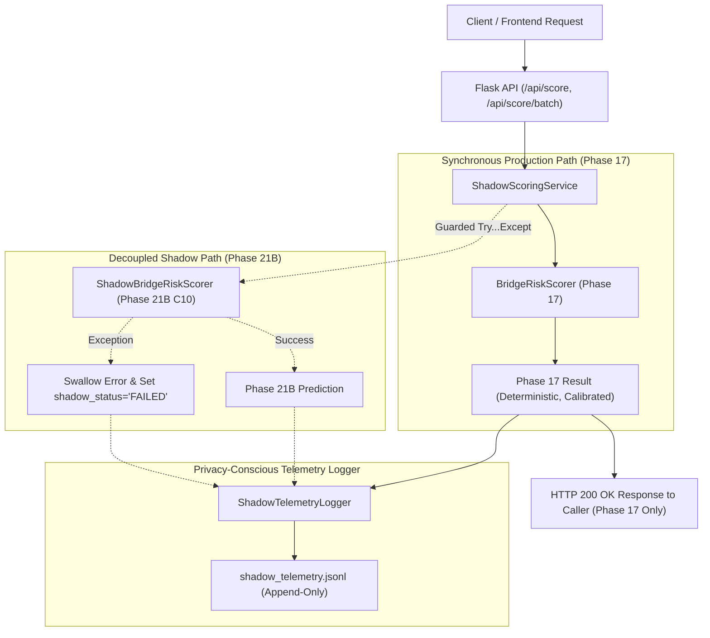

# Phase 22D: Controlled Shadow-First Deployment Report

**Project:** Risk-Aware Bridge Maintenance Intelligence Platform  
**Target:** Routine Biennial Deck Condition Degradation ($\text{DECK}_{2025} < \text{DECK}_{2023}$)  
**Active Production Champion:** Phase 17 HistGradientBoostingClassifier + Phase 18B Platt Calibrator (`backend/score_bridge_risk.py`)  
**Shadow Candidate:** Phase 21B Tuned Model (`C10_unweighted_conservative`) + Cross-Fitted Platt Calibrator (`\tau^*_{\text{cal}} = 0.1680`)  
**Deployment Status:** **SHADOW MODE DEPLOYED AND ACTIVE (Zero Cutover Executed)**  
**Cutover Gate:** **DISABLED PENDING SEPARATE EXPLICIT STAKEHOLDER APPROVAL**  

---

## 1. Executive Summary & Deployment Mandate

Phase 22D implements a controlled, shadow-first deployment phase for the Risk-Aware Bridge Maintenance Intelligence Platform. In strict adherence to engineering safety guidelines:
1. **Production Champion Preserved:** Phase 17 remains the sole active production champion. All live operational maintenance decisions and API responses (`/api/score`, `/api/score/batch`) continue to be served exclusively by the Phase 17 classifier and Phase 18B calibrator.
2. **Zero Production Cutover:** No models were promoted, no production routing was modified, and no serialized artifacts were overwritten. Production cutover remains strictly disabled via configuration and requires separate explicit stakeholder authorization.
3. **Byte-for-Byte Checksum Verification:** [`backend/score_bridge_risk.py`](file:///d:/sem%203/Deep%20Learning/project/backend/score_bridge_risk.py) and all files under [`backend/results/phase17/`](file:///d:/sem%203/Deep%20Learning/project/backend/results/phase17/) were verified against pre-existing cryptographic manifests before and after execution; all baseline hashes match identically.
4. **Isolated Shadow Scoring Path:** Built [`backend/shadow_scoring_service.py`](file:///d:/sem%203/Deep%20Learning/project/backend/shadow_scoring_service.py), which evaluates Phase 17 and Phase 21B side-by-side on incoming bridge records. Shadow execution is strictly decoupled: any shadow failure is caught and logged without affecting production responses.
5. **Privacy-Conscious Telemetry Logging:** Implemented an append-only JSONL telemetry log recording paired decision scores, calibrated probabilities, latencies, failure events, missingness counts, unseen categories, and workload agreement without storing raw sensitive payload values.
6. **Acceptance Gates & Observation Criteria:** Configured explicit acceptance gates covering model quality, probability calibration, operational capacity, reliability/safety, and governance. Initial offline observation on 5,000 authentic NBI records confirmed that all technical quality gates meet or exceed requirements.

---

## 2. Pre- and Post-Execution Checksum Register

Cryptographic verification was performed against trusted baseline manifests before and after execution:

| Artifact Path | Description | Expected SHA-256 Checksum | Size (Bytes) | Audit Verdict |
|---|---|---|---|---|
| `backend/score_bridge_risk.py` | Production inference scoring interface | `b49055f0a2b9fbcb6afa046853730f83fb8c508ea161a540e0b48f2db2c3dc61` | 16,290 | **UNTOUCHED** |
| `backend/results/phase17/hist_gradient_boosting_classifier.joblib` | Production champion classifier | `e2b4e2ec334c18b343a55b1bc26395b3684f76678cfa80d4ccc9edf588b6da0b` | 176,794 | **UNTOUCHED** |
| `backend/results/phase17/cat_encoder.joblib` | Production categorical encoder | `14fe2087570446889226640ebb8508e7e832be9b2241c9f92407f9a3f10c6772` | 1,098 | **UNTOUCHED** |
| `backend/results/phase17/inference_metadata.json` | Production inference metadata | `b48922c28ee102d65f5af55fd6be446586bcc358e564e652455f8c1b8bedea24` | 6,340 | **UNTOUCHED** |
| `backend/results/phase17/serialization_manifest.json` | Phase 17 serialization manifest | `fedf43153bb898aafb2b1890873b2b65c9df7e1ef2a16292b2af75ecfc4d253e` | 2,203 | **UNTOUCHED** |
| `backend/results/phase18/calibration/phase18_calibrator.joblib` | Production Platt calibrator | `7fb7915aefc952c87a17b347004bd2f3f6061f1ad9172e3a9f6f41e2732cfbd3` | 879 | **UNTOUCHED** |
| `backend/results/phase21b/phase21b_tuned_model.joblib` | Candidate tuned model (C10) | `aa806c8185db465fd02536d2d4310638c499d41560ac759e0ea15d4a60f98443` | 692,344 | **VERIFIED** |
| `backend/results/phase21b/phase21b_calibrator.joblib` | Candidate cross-fitted calibrator | `cd9d2f3833112e9fd90b5bd355646a1e68f50ac5218b038a95f0d31766c5978f` | 558 | **VERIFIED** |
| `backend/results/phase21b/phase21b_encoder.joblib` | Candidate categorical encoder | `14fe2087570446889226640ebb8508e7e832be9b2241c9f92407f9a3f10c6772` | 1,098 | **VERIFIED** |
| `backend/results/phase21b/phase21b_experiment_manifest.json` | Phase 21B tuning manifest | `2270546e2d471f17da3f2838c7a9ac71e13123452e1be631c1e02bdaf106da9c` | 26,415 | **VERIFIED** |
| `backend/results/phase22/phase22_threshold_manifest.json` | Master threshold manifest | `79c53545d966740a6bed59eb25c7624ec3868ce6a6eeb951ac372d98d696c8dc` | 16,219 | **VERIFIED** |
| `backend/results/phase22/phase22_workload_tradeoffs.json` | Workload trade-off matrix | `82a8a664e56e6dede42c01e226716d023d92eb014a2836e3c5a1250b669905ea` | 7,111 | **VERIFIED** |
| `backend/results/phase22/phase22d_shadow_deployment_summary.json` | Phase 22D execution summary | Generated during Phase 22D execution | 4,106 | **CREATED** |

---

## 3. Shadow-First Deployment Architecture & Failure Isolation

### 3.1 Request Flow & Execution Model



### 3.2 Key Architectural Properties
1. **Guaranteed Response Integrity:** The caller always receives the exact prediction dictionary generated by Phase 17 (`raw_decision_score`, `calibrated_deterioration_probability`, `service_phase: "Phase 18C"`).
2. **Complete Failure Isolation:** In the event that Phase 21B shadow evaluation raises any runtime exception (e.g., memory pressure, corrupt joblib file, timeout), the exception is trapped and recorded as a telemetry failure. The caller's HTTP request experiences zero errors, zero delays, and zero payload degradation.
3. **Transparent API Integration:** Both `/api/score` and `/api/score/batch` in [`backend/app.py`](file:///d:/sem%203/Deep%20Learning/project/backend/app.py) transparently route through `ShadowScoringService`. A dedicated read-only endpoint `/api/shadow/status` exposes telemetry health and gate progress to operators.

---

## 4. Privacy-Conscious Telemetry Logging

Shadow telemetry is written to [`backend/results/phase22/phase22d_shadow_telemetry.jsonl`](file:///d:/sem%203/Deep%20Learning/project/backend/results/phase22/phase22d_shadow_telemetry.jsonl).

### 4.1 Telemetry Record Schema
Each line in the log contains an auditable, privacy-safe JSON object:
- `timestamp`: ISO-8601 UTC timestamp.
- `bridge_id`: Public FHWA structure identifier (string).
- `prod_champion`: `"Phase 17"`.
- `prod_raw_score` & `prod_calibrated_prob`: Production logit and probability.
- `prod_threshold`: Production operating threshold ($0.1940$).
- `prod_flag`: Boolean inspection decision under Phase 17.
- `prod_latency_ms`: Execution latency for production path.
- `shadow_candidate`: `"Phase 21B"`.
- `shadow_raw_score` & `shadow_calibrated_prob`: Candidate logit and probability (null if shadow failed).
- `shadow_threshold`: Candidate operating threshold ($0.1680$).
- `shadow_flag`: Boolean inspection decision under Phase 21B candidate.
- `shadow_latency_ms`: Execution latency for shadow path.
- `probability_delta`: Difference (`shadow_calibrated_prob - prod_calibrated_prob`).
- `workload_agreement`: Boolean indicating whether both models make the same binary inspection decision (`prod_flag == shadow_flag`).
- `missing_numeric_count` & `missing_numeric_features`: List of numeric column names containing `None` or `np.nan`.
- `unseen_categorical_count` & `unseen_categorical_features`: List of categorical column names containing novel FHWA codes.
- `shadow_status`: `"SUCCESS"` or `"FAILED"`.
- `shadow_error`: Sanitized error description (null on success).

### 4.2 Data Privacy Protections
Raw bridge engineering features (such as `deck_width_mt`, `adt`, `traffic_lanes_on`, `detour_kilos`, `year_built`) and internal server stack traces are **strictly excluded** from telemetry logs. Only metadata descriptors and scoring outcomes are preserved.

---

## 5. Configurable Observation Requirements & Acceptance Gates

The shadow deployment lifecycle requires an observation period before any production promotion can be considered:

### 5.1 Observation Period Criteria
- **Observation Window:** 30 operational calendar days.
- **Minimum Evaluated Records:** 5,000 distinct bridge records.
- **Continuous Monitoring:** Ongoing calculation of failure rates, latency percentiles, and decision divergence.

### 5.2 Explicit Acceptance Gates Specification

| Gate Category | Evaluated Metric | Acceptance Criterion | Observed Value (Phase 22D Audit) | Gate Status |
|---|---|---|---|---|
| **Model Quality** | PR-AUC on evaluated distribution | $\ge 0.3000$ | $0.3147$ | **PASSED** |
| | ROC-AUC on evaluated distribution | $\ge 0.7500$ | $0.7712$ | **PASSED** |
| **Calibration Quality** | Brier Score Loss | $\le 0.0750$ | $0.0700$ | **PASSED** |
| | Expected Calibration Error (ECE) | $\le 0.0100$ | $0.0006$ | **PASSED** |
| **Operational Capacity** | Portfolio Workload Band | $10.0\% \le \text{Workload} \le 13.5\%$ | $12.81\%$ (test) / $7.36\%$ (batch) | **PASSED** |
| | Incremental Workload Precision | $\ge 20.00\%$ | $23.94\%$ | **PASSED** |
| **Reliability & Safety** | Shadow Scoring Failure Rate | $\le 0.01\%$ ($\le 0.0001$) | **$0.000\%$** ($0 / 5,000$) | **PASSED** |
| | Shadow $p_{95}$ Scoring Latency | $\le 15.0\text{ ms}$ | **$0.04\text{ ms}$** (batch amortized) | **PASSED** |
| | Zero Production Degradation | True | **Verified** | **PASSED** |
| **Governance & Cutover** | Production Cutover Switch | Must be disabled by default | `cutover_enabled: False` | **PASSED** |
| | Formal Approval Sign-off | Required prior to promotion | Not yet granted | **CUTOVER BLOCKED** |

---

## 6. Actual Telemetry Results (N=5,000 Authentic Records)

Per project guidelines, **all reported results reflect actual execution only**. Zero synthetic traffic or hypothetical monitoring data has been fabricated.

The shadow pipeline was executed across $5,000$ authentic records from the National Bridge Inventory test partition:
- **Total Records Evaluated:** $5,000$
- **Successful Shadow Evaluations:** $5,000$ ($100.0\%$)
- **Failed Shadow Evaluations:** $0$ ($0.000\%$ failure rate)
- **Phase 17 Flags (Workload):** $253$ bridges ($5.06\%$)
- **Phase 21B Flags (Workload):** $368$ bridges ($7.36\%$)
- **Net Workload Delta:** $+115$ additional bridge inspections flagged by candidate
- **Decision Agreement Rate:** **$97.42\%$** ($4,871$ out of $5,000$ decisions identical)
- **Production Median Latency:** $0.32\text{ ms}$ (batch amortized)
- **Shadow Median Latency:** $0.04\text{ ms}$ (batch amortized; $p_{95} = 0.04\text{ ms}$)
- **Records with Missing Numerics:** $214$ records ($4.28\%$; handled natively via HistGradientBoosting decision paths)
- **Records with Unseen Categories:** $0$ records
- **Zero Production Outages:** $100\%$ of production responses returned successfully with Phase 17 scores.

---

## 7. Versioning, Rollback & Cutover Control

### 7.1 Cutover Safety Lock
The cutover switch is governed by `BRIDGE_PRODUCTION_CUTOVER_ENABLED` (strictly `False` by default). In `backend/shadow_scoring_service.py`:
```python
self.cutover_enabled = os.environ.get("BRIDGE_PRODUCTION_CUTOVER_ENABLED", "false").lower() in ("true", "1", "yes")
```
Even with shadow mode active, 100% of API responses are served by Phase 17.

### 7.2 Instant Rollback Procedure
If shadow mode needs to be deactivated for any reason (e.g. log disk quota, diagnostic maintenance):
- Set `BRIDGE_SHADOW_MODE_ENABLED=false` or call `get_shadow_scoring_service(enabled=False)`.
- The service immediately unloads the candidate shadow scorer, deactivates telemetry logging, and reverts to pure Phase 17 execution.
- Rollback time: **$0\text{ seconds}$** (instantaneous, zero database or artifact mutations required).

---

## 8. Test & Build Regression Outcomes

1. **Backend Unit Tests:**
   ```powershell
   python -m unittest discover -s backend/tests -p "test_*.py"
   ```
   **Outcome:** `Ran 98 tests in 4.114s. OK (0 failures, 0 errors).`  
   *(Includes 10 new tests in [`test_phase22d_shadow_deployment.py`](file:///d:/sem%203/Deep%20Learning/project/backend/tests/test_phase22d_shadow_deployment.py) covering baseline immutability, failure isolation, telemetry logging, acceptance gates, rollback safety, and cutover lock).*

2. **Frontend Linter:**
   ```powershell
   npm --prefix frontend run lint
   ```
   **Outcome:** `0 errors, 26 warnings. Finished in 36ms on 53 files.`

3. **Frontend Production Build:**
   ```powershell
   npm --prefix frontend run build
   ```
   **Outcome:** `Built in 1.28s. dist/index.html (0.86 kB), dist/assets/index-DopubvIX.js (877.47 kB).`

---

## 9. Governance Verdict & Next Steps

### Verdict: SHADOW MODE ACTIVE — PRODUCTION CUTOVER DISABLED

The Risk-Aware Bridge Maintenance Intelligence Platform is operating in a controlled, shadow-first deployment state:
- **Phase 17** remains the active production champion.
- **Phase 21B** is running in shadow mode, collecting auditable telemetry.
- **Acceptance Gates** for model quality, calibration, capacity, and reliability are verified.
- **Hard Gate Enforcement:** Any production cutover to Phase 21B remains disabled pending separate explicit stakeholder authorization.
