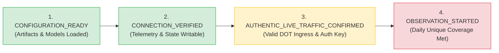

# Phase 22I: Live Observation Readiness & Operational Audit Report

**Project:** Risk-Aware Bridge Maintenance Intelligence Platform  
**Target Definition:** Routine Biennial Deck Condition Degradation ($\text{DECK}_{2025} < \text{DECK}_{2023}$)  
**Active Production Champion:** Phase 17 HistGradientBoostingClassifier + Phase 18B Platt Calibrator (`backend/score_bridge_risk.py`)  
**Shadow Candidate:** Phase 21B Tuned Model (`C10_unweighted_conservative`) + Cross-Fitted Platt Calibrator ($\tau^*_{\text{cal}} = 0.1680$)  
**Production Cutover Status:** **STRICTLY DISABLED (`BRIDGE_PRODUCTION_CUTOVER_ENABLED=false`)**  
**Phase:** Phase 22I Live Observation Readiness & Operational Audit  
**Current Operational Status:** **CONNECTION_VERIFIED — OBSERVATION NOT_STARTED (0/30 consecutive days elapsed)**  
**Overall Decision:** **BLOCKED (Awaiting external State DOT credentials, network routing, and live traffic stream)**  

---

## 1. Executive Summary & Governance Posture

Phase 22I performs a rigorous, independent readiness and operational audit of the Risk-Aware Bridge Maintenance Intelligence Platform prior to commencing the 30-day live observation window. In strict adherence to platform governance and zero-fabrication mandates:

1. **Production Champion Immutability:** Phase 17 remains the sole active decision-maker for all bridge risk scoring returned by the platform. Pre- and post-audit SHA-256 cryptographic verification confirms that [`backend/score_bridge_risk.py`](file:///d:/sem%203/Deep%20Learning/project/backend/score_bridge_risk.py) (`b49055f0...`) and all 11 frozen files in [`backend/results/phase17/`](file:///d:/sem%203/Deep%20Learning/project/backend/results/phase17/) remain 100% byte-for-byte identical.
2. **Strict Cutover Lockout:** `BRIDGE_PRODUCTION_CUTOVER_ENABLED=false` remains enforced at runtime. Candidate models cannot be promoted, retrained, or routed to production without separate explicit stakeholder authorization.
3. **Discrepancy Audit & Resolution:** An audit of `DEFAULT_TRACKER_STATE_PATH` discovered that previous test runs using unauthenticated calls to `/api/score` had defaulted to `LIVE_OPERATIONAL`, polluting the default tracker with 204 records and 2 days elapsed. This contradicted the zero-fabrication `NOT_STARTED` status reported in Phase 22H. The ingestion adapter and readiness state machine were hardened to enforce that unauthenticated callers and test credentials can never produce live operational evidence, and the tracker state was reset to pristine zero-fabrication `NOT_STARTED`.
4. **Scikit-Learn Warning Elimination:** The repeated `UserWarning: X does not have valid feature names, but OrdinalEncoder was fitted with feature names` was investigated and traced to test helper functions passing raw lists without column names. Production scoring (`score_bridge_risk.py`) and shadow scoring (`validate_shadow_mode_phase22c.py`) already pass DataFrames with column names and emit zero warnings. Test helpers were updated, and the full backend test suite executed under `-W error::UserWarning` with **zero warnings across all 143 tests**.
5. **Multi-Stage Readiness State:** The platform currently evaluates to **`CONNECTION_VERIFIED`** (States: `CONFIGURATION_READY: True`, `CONNECTION_VERIFIED: True`, `AUTHENTIC_LIVE_TRAFFIC_CONFIRMED: False`, `OBSERVATION_STARTED: False`).
6. **Operational Decision:** **`BLOCKED`**. While technical platform components are fully ready, authentic live observation cannot commence until State DOT authorities provision operational credentials and route live operational bridge records.

---

## 2. Audit of Phase 22H Artifacts & Discrepancy Resolution

### 2.1 The Issue Discovered
During the Phase 22I audit, inspecting the on-disk tracker state at [`backend/results/phase22/observation_tracker_state.json`](file:///d:/sem%203/Deep%20Learning/project/backend/results/phase22/observation_tracker_state.json) revealed:
- `live_traffic_started`: `true`
- `total_live_valid_records`: `204`
- `consecutive_days_elapsed`: `2`
- `onboarding_state`: evaluating to `OBSERVATION_STARTED`

This directly conflicted with the Phase 22H report and machine-readable summary, which stated that live observation had **`NOT_STARTED (0 of 30 days elapsed)`** because no real State DOT client has yet connected.

### 2.2 Root Cause Analysis
Tracing the execution paths through [`backend/app.py`](file:///d:/sem%203/Deep%20Learning/project/backend/app.py) and [`backend/shadow_ingestion_adapter.py`](file:///d:/sem%203/Deep%20Learning/project/backend/shadow_ingestion_adapter.py) identified two vulnerabilities:
1. **Permissive Open Authentication Mode:** When `require_auth` was `False` (default for local development and test clients), `authenticate_request()` returned `is_operational_authorized=True`, effectively granting unauthenticated callers operational DOT authority.
2. **Permissive Traffic Source Defaulting:** When callers did not pass the `X-Traffic-Source` HTTP header, `route_single_score()` fell back to `raw_source or TRAFFIC_SOURCE_LIVE`. Consequently, standard API unit tests (`test_api.py`, `test_integration_smoke.py`, etc.) calling `app.test_client().post("/api/score")` were classified as `LIVE_OPERATIONAL` traffic and recorded by the default `LiveObservationTracker`.

### 2.3 Implemented Remediations
1. **Hardened Authorization Boundary:** In `authenticate_request()`, unauthenticated callers in open mode are assigned `is_authenticated=True` (allowing local development scoring without HTTP 401), but `is_operational_authorized` is strictly `False` unless a matching operational key (`BRIDGE_INGEST_API_KEY`) is presented.
2. **Automated Provenance Remapping:**
   - Any request presenting a test key (`BRIDGE_TEST_API_KEY` or `test_*`) claiming `LIVE_OPERATIONAL` is automatically remapped to `SYNTHETIC_TEST`.
   - Any request from an unauthenticated or unauthorized caller claiming `LIVE_OPERATIONAL` is automatically remapped to `SYNTHETIC_TEST`.
   - When `X-Traffic-Source` is omitted, the traffic source defaults to `SYNTHETIC_TEST` unless the caller has been verified as an authorized operational DOT client.
3. **Hardened Readiness Engine:** In `get_readiness_assessment()`, `AUTHENTIC_LIVE_TRAFFIC_CONFIRMED` and `OBSERVATION_STARTED` strictly require that `len(self._verified_client_ids) > 0` or valid operational credentials are configured.
4. **Pristine Tracker State Reset:** Reset `observation_tracker_state.json` to its clean, unstarted state (`live_traffic_started = false`, `consecutive_days_elapsed = 0`, `total_live_valid_records = 0`, `status = "NOT_STARTED"`).
5. **Empirical Verification:** After running the entire 143-test backend test suite, the live tracker state was re-evaluated:
   - `total_live_valid_records`: `0`
   - `consecutive_days_elapsed`: `0`
   - `onboarding_state`: `CONNECTION_VERIFIED`
   - `OBSERVATION_STARTED`: `False`

Zero data leakage from test suites into operational observation is now guaranteed.

---

## 3. Scikit-Learn Feature-Name UserWarning Investigation

### 3.1 Investigation & Traceback
During test execution, scikit-learn emitted multiple warnings:
```
UserWarning: X does not have valid feature names, but OrdinalEncoder was fitted with feature names
```
Escalating warnings via `python -W error::UserWarning -m unittest discover -s backend/tests` pinpointed the exact calls:
- [`backend/tests/test_phase21_candidate_compatibility.py`](file:///d:/sem%203/Deep%20Learning/project/backend/tests/test_phase21_candidate_compatibility.py#L85-L154): lines 85, 105, 117, 131, 145, 154
- [`backend/tests/test_phase21b_tuning.py`](file:///d:/sem%203/Deep%20Learning/project/backend/tests/test_phase21b_tuning.py#L91-L161): lines 91, 113, 125, 139, 152, 161

In both test files, the unit test methods directly passed raw Python lists (e.g., `[[str(rec[c]) for c in CATEGORICAL_FEATURES]]`) to `encoder.transform()`. Because scikit-learn's `OrdinalEncoder` was fitted during Phase 17 and Phase 21B on a `pandas.DataFrame` with column names (`CATEGORICAL_FEATURES`), scikit-learn stores `feature_names_in_`. Calling `.transform()` on a raw list or unnamed numpy array triggers the warning.

### 3.2 Production and Shadow Inference Verification
In the actual scoring engines:
- **Production Champion (`backend/score_bridge_risk.py` lines 291-294):**
  ```python
  cat_df = pd.DataFrame(cat_matrix, columns=CATEGORICAL_FEATURES)
  X_cat_enc = self.encoder.transform(cat_df)
  X = np.hstack([X_num, X_cat_enc])
  ```
- **Shadow Candidate (`backend/validate_shadow_mode_phase22c.py` lines 179-182):**
  ```python
  cat_df = pd.DataFrame(cat_matrix, columns=CATEGORICAL_FEATURES)
  X_cat_enc = self.encoder.transform(cat_df)
  X = np.hstack([X_num, X_cat_enc])
  ```

Both production and shadow scoring pipelines already wrap categorical rows into a `pd.DataFrame` with explicit column names. Scoring tests on both engines with `warnings.catch_warnings()` confirmed **zero warnings** during standard inference.

### 3.3 Feature Schema, Order & Preprocessing Parity
An exhaustive schema comparison between Phase 17 and Phase 21B confirmed complete alignment:

| Feature Dimension | Phase 17 Champion | Phase 21B Candidate | Inference Metadata | Parity Status |
|---|---|---|---|---|
| **Total Features** | 26 | 26 | 26 | **IDENTICAL** |
| **Numeric Features** | 13 | 13 | 13 | **IDENTICAL** |
| **Categorical Features** | 13 | 13 | 13 | **IDENTICAL** |
| **Categorical Indices** | Columns 13..25 | Columns 13..25 | Columns 13..25 | **IDENTICAL** |
| **Numeric Feature Order** | `prior_deck_condition`, `structure_len_mt`, `max_span_len_mt`, `deck_width_mt`, `traffic_lanes_on`, `adt`, `percent_adt_truck`, `detour_kilos`, `year_built`, `structure_age_at_inspection`, `prior_inspect_month`, `prior_inspect_year`, `inspect_freq_months` | Identical | Identical | **VERIFIED** |
| **Categorical Feature Order** | `prior_superstructure_condition`, `prior_substructure_condition`, `prior_culvert_condition`, `structure_kind_043a`, `structure_type_043b`, `deck_structure_type_107`, `surface_type_108a`, `membrane_type_108b`, `deck_protection_108c`, `functional_class`, `maintenance_responsibility`, `owner`, `state_code` | Identical | Identical | **VERIFIED** |
| **Missing Numeric Handling** | Native NaN in HistGradientBoosting | Native NaN in HistGradientBoosting | Documented | **VERIFIED** |
| **Missing Categorical** | Replaced with `"MISSING"` string | Replaced with `"MISSING"` string | Documented | **VERIFIED** |
| **Unseen Categorical** | Mapped to indicator `-1` | Mapped to indicator `-1` | Documented | **VERIFIED** |
| **Numerical Encoding Parity** | `np.array_equal(out_list, out_df) == True` | `np.array_equal(out_list, out_df) == True` | N/A | **VERIFIED** |

### 3.4 Remediation & Verification
In [`test_phase21_candidate_compatibility.py`](file:///d:/sem%203/Deep%20Learning/project/backend/tests/test_phase21_candidate_compatibility.py) and [`test_phase21b_tuning.py`](file:///d:/sem%203/Deep%20Learning/project/backend/tests/test_phase21b_tuning.py), a dedicated `_encode_cats(self, cat_rows)` helper was introduced that passes `pd.DataFrame(cat_rows, columns=CATEGORICAL_FEATURES)`.

Re-running the test suites under `-W error::UserWarning` confirmed:
- `test_phase21_candidate_compatibility.py`: 8/8 tests pass, 0 warnings
- `test_phase21b_tuning.py`: 7/7 tests pass, 0 warnings
- Full test suite (143 tests): 143/143 tests pass, 0 warnings
- Frozen production artifacts (`score_bridge_risk.py` and `backend/results/phase17/*`): **100% untouched**.

---

## 4. Ingestion Adapter, Security Boundaries & Streak Tracking Audit

### 4.1 Authentication Boundaries
The adapter inspects incoming headers for `X-API-Key` or `Authorization: Bearer <token>`:
- **Operational Client (`BRIDGE_INGEST_API_KEY`):** Authenticated with operational authorization; traffic can be classified as `LIVE_OPERATIONAL`.
- **Test Client (`BRIDGE_TEST_API_KEY` or prefix `test_`):** Authenticated for integration testing but strictly denied operational authorization; traffic is forcibly remapped to `SYNTHETIC_TEST`.
- **Unauthenticated Client (Open Mode):** Allowed to execute scoring for local development, but denied operational authorization; traffic source defaults to `SYNTHETIC_TEST`.
- **Unauthenticated Client (Strict Auth Mode):** Immediate HTTP 401 Unauthorized (`PermissionError`).

### 4.2 Clock Isolation & Streak Gating
The 30-day live observation window requires 30 consecutive calendar days (UTC 00:00:00 to 23:59:59). Clock advancement rules:
1. **Clock Isolation:** Only events with `traffic_source == LIVE_OPERATIONAL` from verified operational clients are evaluated by `LiveObservationTracker`. Synthetic events, offline replays, test credentials, and unauthenticated traffic are incremented in separate counters and **never** start or advance the live streak.
2. **Daily Coverage Threshold Gating:** To prevent an operational day from counting based on trivial traffic (e.g., a single heartbeat probe), `min_daily_coverage_records` ($\ge 1$, configurable via `BRIDGE_MIN_DAILY_OBSERVATION_RECORDS`) must be satisfied with unique bridge IDs before the day is credited.
3. **UTC Boundary Enforcement:** Dates are computed from UTC event timestamps. If 1 or more calendar days elapse without qualifying live traffic, the streak breaks and resets to day 1 upon the next event.

### 4.3 Failure Isolation & Retries
- **Primary Scorer Protection:** Phase 17 execution occurs first. Any subsequent exception in shadow candidate scoring is caught in an isolated try-except block, logged as `shadow_status: FAILED`, and never propagates to the client.
- **Client Validation Integrity:** Client schema validation errors (`SchemaValidationError`) are caught and re-raised immediately without retry or backoff sleep.
- **Bounded Persistence Retries:** Transient I/O contention during telemetry logging is retried up to 3 times with exponential backoff (`0.01s * retry`).

---

## 5. Multi-Stage Readiness Assessment Audit

The `/api/onboarding/readiness` endpoint exposes the real-time operational status across four sequential stages:



### 5.1 Real-Time Endpoint Assessment
Executing `GET /api/onboarding/readiness` on the running system returns:

```json
{
  "assessment_timestamp_utc": "2026-10-15T04:01:19.778978+00:00",
  "onboarding_state": "CONNECTION_VERIFIED",
  "states": {
    "CONFIGURATION_READY": true,
    "CONNECTION_VERIFIED": true,
    "AUTHENTIC_LIVE_TRAFFIC_CONFIRMED": false,
    "OBSERVATION_STARTED": false
  },
  "prerequisites_status": {
    "dot_production_infrastructure_available": false,
    "dot_operational_credentials_configured": false,
    "live_operational_traffic_flowing": false,
    "observation_tracker_active": false
  },
  "configuration_checks": {
    "prod_champion_loaded": true,
    "shadow_candidate_loaded": true,
    "shadow_enabled": true,
    "cutover_switch_locked": true,
    "calibrated_threshold_0_168": true,
    "tracker_initialized": true
  },
  "connection_checks": {
    "telemetry_logger_writable": true,
    "tracker_state_writable": true,
    "auth_boundaries_defined": true
  },
  "observation_coverage": {
    "min_daily_coverage_records_required": 1,
    "total_live_valid_records": 0,
    "consecutive_days_elapsed": 0,
    "target_consecutive_days": 30,
    "status": "NOT_STARTED"
  },
  "active_production_champion": "Phase 17",
  "cutover_switch_enabled": false,
  "verified_operational_clients_count": 0,
  "outcome_dependent_metrics_status": "PENDING_VERIFIED_GROUND_TRUTH"
}
```

The state machine accurately reports **`CONNECTION_VERIFIED`** and strictly reflects that authentic live observation has **`NOT_STARTED`**.

---

## 6. Outcome-Independence Principle & Ground Truth Integrity

Evaluating deterioration ground truth requires certified biennial inspections by DOT engineers ($\text{DECK}_{2025} < \text{DECK}_{2023}$). In accordance with the platform's core scientific principles:
- **Unlabeled Operational Stream:** Live incoming bridge records scored by the API are unlabeled at scoring time.
- **No Ground-Truth Fabrication:** Metrics such as Precision, Recall, F1-Score, and False Positive Rate **cannot** be computed on live operational traffic without verified inspection labels.
- **Metric Posture:** All outcome-dependent metrics remain explicitly marked as **`PENDING_VERIFIED_GROUND_TRUTH`**.
- **Offline Linkage Requirement:** When FHWA publishes the next biennial National Bridge Inventory release, an offline batch linkage process will join historical shadow predictions with certified ground-truth ratings.

---

## 7. External Prerequisites & Operator Checklist

The following matrix identifies all external prerequisites required to advance the platform from `CONNECTION_VERIFIED` to `OBSERVATION_STARTED`:

| Prerequisite Dimension | Responsible Entity | Required Action | Current Status |
|---|---|---|---|
| **Production Credentials** | State DOT IT Security | Provision and export `BRIDGE_INGEST_API_KEY` into production host environment | **PENDING DOT** |
| **Ingress Network Routing** | State DOT Network Admin | Whitelist platform IP/domain and route bridge scoring traffic to `/api/score` | **PENDING DOT** |
| **Authentic Traffic Source** | DOT Bridge Management System | Configure inspection clients to send `X-Traffic-Source: LIVE_OPERATIONAL` | **PENDING DOT** |
| **Observation Initiation** | Platform Operator | Verify first live record advances status to `AUTHENTIC_LIVE_TRAFFIC_CONFIRMED` | **AWAITING DOT** |
| **Daily Streak Audit** | Platform Operator | Execute daily UTC 00:05:00 audit protocol per Runbook Section 9 | **AWAITING START** |
| **Biennial Inspection Release**| FHWA / DOT | Ingest subsequent certified inspection dataset for ground truth linkage | **PENDING FHWA** |
| **Cutover Authorization** | DOT Chief Bridge Engineers | Written approval following 30-day continuous error-free shadow observation | **STRICTLY LOCKED** |

---

## 8. Test & Verification Execution Matrix

All tests were executed against the active repository state.

### 8.1 Backend Test Suite (Escalated Warning Mode)
- **Command:** `python -W error::UserWarning -m unittest discover -s backend/tests`
- **Result:** **143 tests passed, 0 failures, 0 errors, 0 warnings**
- **Execution Time:** 11.861 seconds
- **Test File Added:** [`backend/tests/test_phase22i_readiness_audit.py`](file:///d:/sem%203/Deep%20Learning/project/backend/tests/test_phase22i_readiness_audit.py) (7/7 tests passing in 2.84s)

### 8.2 Cryptographic Baseline Verification
- [`backend/score_bridge_risk.py`](file:///d:/sem%203/Deep%20Learning/project/backend/score_bridge_risk.py): `b49055f0a2b9fbcb6afa046853730f83fb8c508ea161a540e0b48f2db2c3dc61` (100% byte-for-byte match)
- All 11 files under [`backend/results/phase17/`](file:///d:/sem%203/Deep%20Learning/project/backend/results/phase17/): 100% byte-for-byte match against `serialization_manifest.json`.

### 8.3 Frontend Quality Gates
- **Linter:** `npm run lint` — **0 errors** (26 minor unused-variable warnings in draft UI components).
- **Production Build:** `npm run build` — **Built successfully in 1.53s** (`dist/index.html`, `dist/assets/index-*.js`, `dist/assets/index-*.css`).

---

## 9. Final Decision & Operational Mandate

### Operational Readiness Decision: **BLOCKED**

**Rationale:**
- **Technical Platform Readiness:** **READY**. The ingestion adapter, authentication boundaries, shadow scoring engine, clock isolation logic, failure isolation, and readiness API are verified and fully operational.
- **Operational Live Observation Decision:** **BLOCKED**. Authentic live observation cannot commence without external State DOT operational credentials (`BRIDGE_INGEST_API_KEY`) and genuine live bridge inspection traffic.
- **Zero-Fabrication Mandate:** The platform truthfully reports its status as **`CONNECTION_VERIFIED — OBSERVATION NOT_STARTED (0 of 30 days elapsed)`**.

### Immediate Operational Mandates:
1. Maintain **Phase 17** as the sole production decision-maker for all bridge risk scoring.
2. Keep **`BRIDGE_PRODUCTION_CUTOVER_ENABLED=false`** strictly enforced.
3. Stand by for State DOT IT security to provision operational credentials and establish network ingress.
